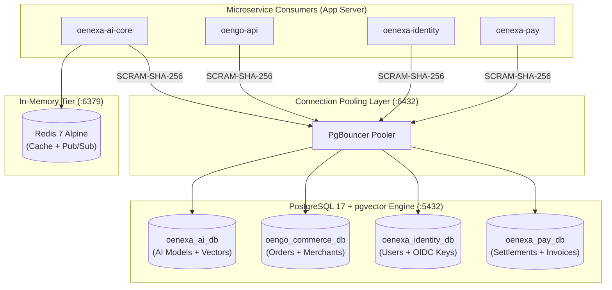

# 🗄️ OENEXA Enterprise Database Platform (`oenexa-database`)

> **Master Database Platform, Cluster Topologies, and Storage Infrastructure**  
> **Authority:** Principal Database Architect & Enterprise SRE  
> **Classification:** Enterprise Tier-1 Database Infrastructure

---

## 🌟 1. Mission & Architecture Overview

`oenexa-database` manages the dedicated database infrastructure, configurations, provisioning scripts, and backup automation across the Oenexa ecosystem.

Adhering strictly to the **Database-per-Service Pattern**, all microservices own completely isolated logical databases and credentials. No service is permitted to connect directly to another service's database or run cross-database queries.



---

## 💎 2. Technology Stack & Industry Standards

| Component | Technology | Role in Oenexa Ecosystem |
| :--- | :--- | :--- |
| **Relational & Vector Workhorse** | **PostgreSQL 17.x** + `pgvector` | ACID transactions, JSONB document querying, and HNSW vector index retrieval for AI models. |
| **Connection Pooling** | **PgBouncer 1.23** | Multiplexes thousands of client connections down to optimized connection pools, preventing starvation. |
| **In-Memory Cache & Stream** | **Redis 7.x Alpine** | Sub-millisecond session caching, token rate-limiting, and distributed locks. |
| **Blockchain Key-Value** | **LevelDB / RocksDB** | Cryptographic state root and Merkle Patricia Trie (embedded inside `oenexa-node`). |
| **Backup Engine** | `pg_dump` + `pg_restore` (Custom format) | Automated compressed logical backups with retention policies. |

---

## 🚀 3. Quickstart & Local Execution

### 1. Launch Local Database Stack
```bash
# From oenexa-database directory
cp .env.example .env
docker compose up -d
```

### 2. Verify Database Health
```bash
bash scripts/healthcheck.sh
```

### 3. Connect as Service User
```bash
# Connect to AI database
psql -h localhost -p 5432 -U oenexa_ai_app -d oenexa_ai_db

# Connect to Quick-Commerce database
psql -h localhost -p 5432 -U oengo_app -d oengo_commerce_db
```

---

## 🔒 4. Security & Least Privilege

1. **Host-Based Access (`pg_hba.conf`):** All connections require modern `SCRAM-SHA-256` password hashing. Plaintext and MD5 authentication are disabled.
2. **Network Isolation:** In production, database ports are bound to `127.0.0.1` or private WireGuard interfaces only. Public internet exposure is strictly blocked.
3. **Restricted Privileges:** Service users (`oenexa_ai_app`, `oengo_app`) do not have `SUPERUSER`, `CREATEDB`, or `CREATEROLE` permissions. They can only read and write within their designated schema.
4. **Slow Query Auditing:** `pg_stat_statements` tracks execution metrics; queries exceeding 250ms are logged for index optimization.

---

## 💾 5. Backup & Disaster Recovery

Run automated backup with rotation:
```bash
bash scripts/backup.sh
```

Restore a backup into a target database:
```bash
bash scripts/restore.sh oengo_commerce_db /opt/oenexa/backups/postgres/oengo_commerce_db_20261116.sql.gz
```
