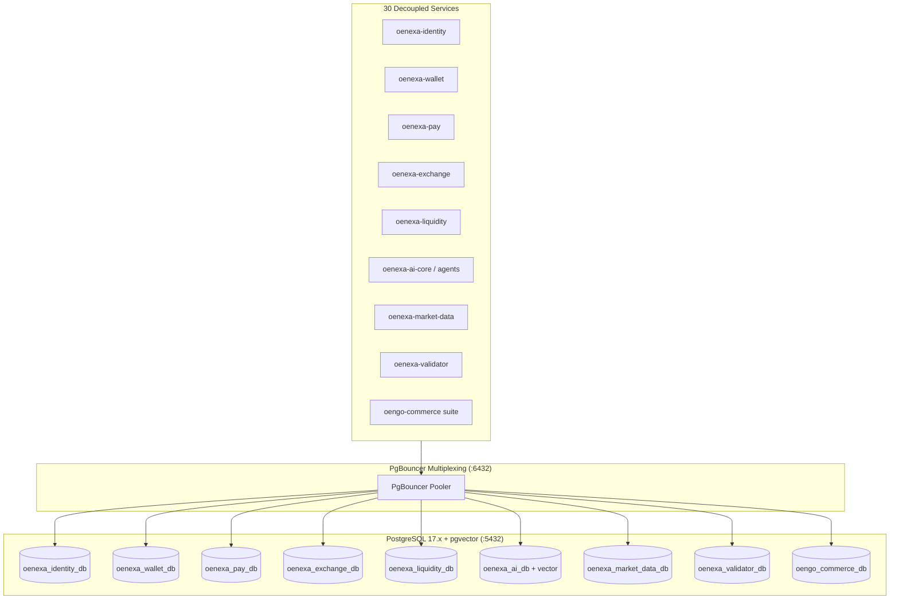

# 🗄️ OENEXA Enterprise Database Platform (`oenexa-database`)

> **Master Database Platform, Cluster Topologies, and Storage Infrastructure**  
> **Authority:** Principal Database Architect & Enterprise SRE  
> **Classification:** Enterprise Tier-1 Database Infrastructure  
> **Governance Standard:** [DATABASE_GOVERNANCE_STANDARD.md](docs/DATABASE_GOVERNANCE_STANDARD.md)

---

## 🌟 1. Mission & Architecture Overview

`oenexa-database` manages the dedicated database infrastructure, configurations, relational schemas, provisioning scripts, and backup automation across the Oenexa ecosystem.

Adhering strictly to the **Database-per-Service Pattern**, all microservices own completely isolated logical databases and credentials. No service is permitted to connect directly to another service's database or run cross-database queries.



---

## 💎 2. Enterprise Relational Domain Schemas

All schemas are engineered from scratch using PostgreSQL 17 features: **UUID Primary Keys**, **Strict Foreign Key Constraints**, **B-tree/GIN/HNSW Indexes**, and **TIMESTAMPTZ** audit trails:

| Domain | Database | Schema Path | Core Entities |
| :--- | :--- | :--- | :--- |
| **01. Identity & Access** | `oenexa_identity_db` | `schemas/01_identity/` | `users`, `credentials`, `mfa_factors`, `sessions`, `roles`, `oidc_clients`, `audit_logs` |
| **02. Wallet & Custody** | `oenexa_wallet_db` | `schemas/02_wallet/` | `accounts`, `account_balances`, `journal_entries`, `ledger_postings`, `shielded_notes`, `transactions` |
| **03. Tri-Rail Pay** | `oenexa_pay_db` | `schemas/03_pay/` | `pay_merchants`, `payment_intents`, `invoices`, `settlements`, `webhook_deliveries` |
| **04. Exchange & Orders** | `oenexa_exchange_db` | `schemas/04_exchange/` | `trading_pairs`, `orders`, `trade_executions`, `candlestick_bars` |
| **05. AMM Liquidity** | `oenexa_liquidity_db` | `schemas/05_liquidity/` | `amm_pools`, `lp_positions`, `amm_swaps`, `liquidity_events` |
| **06. AI & Autonomous Swarms** | `oenexa_ai_db` | `schemas/06_ai/` | `ai_agents`, `swarm_sessions`, `swarm_tasks`, `agent_messages`, `rag_document_chunks` (HNSW) |
| **07. Market Data** | `oenexa_market_data_db` | `schemas/07_market_data/` | `tickers`, `orderbook_depth_snapshots`, `oracle_price_attestations` |
| **08. PoS Consensus** | `oenexa_validator_db` | `schemas/08_validator/` | `validators`, `delegations`, `epoch_rewards`, `slashing_events` |
| **09. Quick Commerce** | `oengo_commerce_db` | `schemas/09_commerce/` | `merchants`, `stores`, `menus`, `items`, `customers`, `orders`, `drivers`, `missions` |

---

## 🚀 3. Quickstart & Local Execution

### 1. Launch Local Database Stack
```bash
# From oenexa-database directory
cp .env.example .env
docker compose up -d
```
*On first boot, `init/01-init-databases.sh` automatically provisions all 9 databases, creates least-privilege roles, enables extensions, and applies the complete relational schemas.*

### 2. Verify Database Health
```bash
bash scripts/healthcheck.sh
```

---

## 🔒 4. Governance & Security Rules

All developers and AI agents must comply with [DATABASE_GOVERNANCE_STANDARD.md](docs/DATABASE_GOVERNANCE_STANDARD.md):
1. **Never share databases:** Cross-database queries or foreign keys between different databases are forbidden.
2. **UUID Primary Keys:** Use `id UUID PRIMARY KEY DEFAULT uuid_generate_v4()`. No auto-increment serial IDs.
3. **Mandatory Foreign Key Indexing:** Every foreign key must have an explicit B-tree index.
4. **Least-Privilege Roles:** Applications connect with their dedicated service role, never as PostgreSQL superuser.
5. **Single Responsibility Ceiling:** Schema and migration files must remain under 385 lines.
