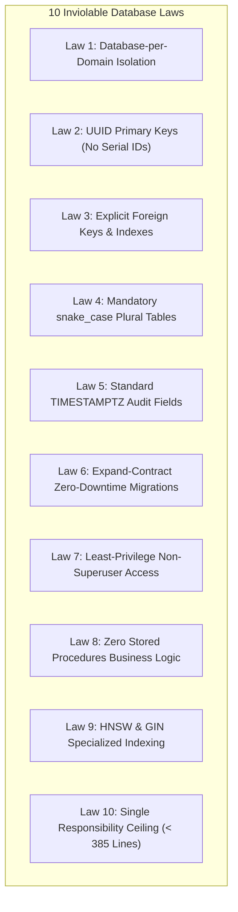

# 🏛️ OENEXA Enterprise Database Governance Standard
**Document Code:** STD-DBA-2026-001  
**Classification:** Mandatory Industrial Standard for Human Developers & AI Agents  
**Authority:** Principal Database Architect & Enterprise Security Officer  

---

## 🌟 1. The 10 Inviolable Database Laws

Every developer and autonomous AI agent designing, modifying, or querying databases in the Oenexa ecosystem must strictly adhere to these 10 laws. Any pull request or schema alteration that violates these rules will be rejected.



---

## 🛡️ 2. Detailed Law Specifications

### Law 1: Database-per-Domain (Zero Shared Databases)
* Each microservice domain owns its logical database exclusively.
* **PROHIBITED:** Cross-database SQL joins, shared tables, or shared credentials.
* If Service A needs data from Service B, it must call Service B's network API.

### Law 2: UUID Primary Keys (No Auto-Increment IDs)
* Every table must declare a UUID primary key:
  ```sql
  id UUID PRIMARY KEY DEFAULT uuid_generate_v4()
  ```
* **PROHIBITED:** Sequential integer IDs (`SERIAL`, `BIGSERIAL`). Sequential IDs expose business volume to competitors and are vulnerable to enumeration attacks.

### Law 3: Explicit Foreign Keys & Mandatory FK Indexing
* All inter-table relationships within a database must declare explicit `REFERENCES parent_table(id)`.
* Every foreign key column must have a corresponding index to prevent table-scan locks during updates and deletes:
  ```sql
  CREATE INDEX idx_orders_customer ON orders(customer_id);
  ```

### Law 4: Naming Conventions (Strict snake_case)
* **Tables:** Lowercase plural nouns (e.g. `users`, `merchants`, `order_items`, `candlestick_bars`).
* **Columns:** Lowercase singular snake_case (e.g. `order_code`, `total_amount`, `ip_address`).
* **Foreign Keys:** Target singular name + `_id` (e.g. `customer_id`, `merchant_id`).
* **Booleans:** Prefix with `is_`, `has_`, or `can_` (e.g. `is_active`, `has_mfa`).

### Law 5: Standard Timestamp Columns (TIMESTAMPTZ)
* Every table must record timezone-aware timestamps:
  ```sql
  created_at TIMESTAMPTZ NOT NULL DEFAULT CURRENT_TIMESTAMP
  ```
* Mutable records must include `updated_at TIMESTAMPTZ NOT NULL DEFAULT CURRENT_TIMESTAMP`.

### Law 6: The "Expand-Contract" Migration Rule
* **PROHIBITED:** Dropping, renaming, or modifying column nullability in a single deployment.
* Schema evolution must follow the multi-stage Expand-Contract pattern:
  1. **Phase 1 (Expand):** Add the new column as nullable; code writes to both old and new.
  2. **Phase 2 (Backfill):** Run batch updates to backfill legacy rows.
  3. **Phase 3 (Contract):** Switch reads to the new column, then drop the old column in a later release.

### Law 7: Least-Privilege Application Connection
* Applications must **never connect as PostgreSQL `superuser` or `postgres`**.
* Each application connects with its dedicated role (e.g. `oenexa_ai_app`, `oengo_app`), restricted strictly to `SELECT, INSERT, UPDATE, DELETE` on its schema.

### Law 8: Zero Business Logic in Stored Procedures
* Stored procedures and functions must be used **only** for data integrity triggers (e.g. updating `updated_at`).
* All domain rules, validations, and business workflows belong in application code.

### Law 9: Specialized Indexing (HNSW & GIN)
* All vector embeddings must be indexed with HNSW for sub-millisecond retrieval:
  ```sql
  CREATE INDEX idx_rag_embedding ON rag_document_chunks USING hnsw (embedding vector_cosine_ops);
  ```
* All searchable `JSONB` columns must use GIN indexes:
  ```sql
  CREATE INDEX idx_audit_meta ON audit_logs USING GIN (metadata);
  ```

### Law 10: Single Responsibility Ceiling (< 385 Lines)
* Every schema DDL and migration file must remain strictly under **385 lines of code**.
* Large schemas must be decomposed across domain subdirectories.
